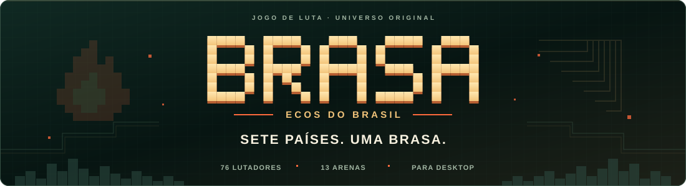
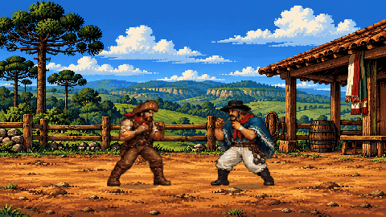

<p align="center">
  
</p>

<p align="center">
  <strong>O Brasil vira arena. A luta ganha o mundo.</strong><br>
  Um jogo de luta 2D em pixel art, com causos, personagens e histórias originais.
</p>

<p align="center">
  <strong>Português (Brasil)</strong> · <a href="docs/i18n/README.en.md">English</a>
</p>

<p align="center">
  <a href="https://github.com/rodrigosantossilv/brasa-ecos-do-brasil/releases/tag/v0.16.0"></a>
  <a href="#jogar"></a>
  <a href="#controles"></a>
  <a href="https://github.com/rodrigosantossilv/brasa-ecos-do-brasil/actions/workflows/ci.yml"></a>
</p>

<p align="center">
  <a href="https://github.com/rodrigosantossilv/brasa-ecos-do-brasil/releases/download/v0.16.0/BRASA-PC-v0.16.zip"><strong>Baixar para Windows</strong></a> ·
  <a href="docs/README.md"><strong>Documentação</strong></a> ·
  <a href="#controles"><strong>Controles</strong></a>
</p>

<p align="center">
  
  <br><sub>Prévia da versão 0.14.0 · Bento × Ramiro, arena Pampa.</sub>
</p>

<p align="center">
  <a href="#o-jogo">O jogo</a> · <a href="#jogar">Comece a jogar</a> · <a href="#desenvolver">Código-fonte</a> · <a href="#documentacao">Guias</a>
</p>

<a id="o-jogo"></a>

## Novidades da versão 0.16

Caminhada refeita para os 76 lutadores: 64 quadros por direção, roupa consistente e apoio dos pés. O combate ganhou relógio de golpes por frame, defesa corrigida e comandos direcionais opcionais. No treino, o laboratório permite pausar, avançar um frame, testar guarda e consultar contato, comandos e vantagem. Os botões simples do PS5 e Xbox continuam disponíveis. Veja [o que mudou](docs/COMBAT_V16.md) e o [histórico](CHANGELOG.md).

## Causos que entram na luta

Do sertão de Bento Brasa à ginga de Jana Faísca, cada lutador carrega uma história para a arena. O elenco parte do Brasil, encontra convidados internacionais e chega aos quatro guardiões lunares secretos.

| 76 lutadores | 13 arenas | Quatro modos de jogo |
|---|---|---|
| Personagens, estilos, três especiais e um super por lutador. | Paisagens brasileiras, cenários internacionais e uma viagem à Lua. | História, duelo contra a CPU, versus local para dois jogadores e treino livre. |

Teclado ou até dois controles na mesma máquina, com comandos remapeáveis e configurações salvas no perfil local. O multiplayer é local.

<a id="jogar"></a>

## Jogar no Windows

**Pacote de desenvolvimento v0.16.0.** Requer Windows 10/11 e Edge ou Chrome instalado.

1. Baixe [BRASA-PC-v0.16.zip](https://github.com/rodrigosantossilv/brasa-ecos-do-brasil/releases/download/v0.16.0/BRASA-PC-v0.16.zip).
2. Extraia o ZIP em uma pasta.
3. Abra **BRASA.exe** e escolha seu modo de jogo.

O pacote reúne os recursos para jogar offline. Veja as [notas da versão](https://github.com/rodrigosantossilv/brasa-ecos-do-brasil/releases/tag/v0.16.0) e os [checksums SHA-256](https://github.com/rodrigosantossilv/brasa-ecos-do-brasil/releases/download/v0.16.0/SHA256SUMS.txt). O download segue as permissões do repositório privado.

<a id="controles"></a>

## Controles

| Ação | Teclado P1 | PlayStation 4/5 | Xbox One/Series |
|---|---|---|---|
| Mover / pular / agachar | A D / W / S | Direcional ou analógico esquerdo | Direcional ou analógico esquerdo |
| Leve / forte / chute | F / G / H | × / □ / ○ | A / X / B |
| Especiais 1 / 2 / 3 | R neutro / S+R / Frente+R | △ / R2 / L2 | Y / RT / LT |
| Defesa | Para trás ou Shift esquerdo | Para trás ou L1 | Para trás ou LB |
| Agarrão | T | R1 | RB |
| Super com barra cheia | G+R | R3 (clique) | RS (clique) |
| Pausa | Esc | Options | Menu |

**P2 no teclado:** setas para mover, J/K/L para golpes, O para especial, P para agarrão e Shift direito para defender. Dois toques na mesma direção fazem um dash curto. “Frente” acompanha o lado do adversário.

Abra **CONTROLES** no jogo para remapear. Os controles usam a API Gamepad; conexão e identificação dependem do sistema. O [guia de golpes e controles](docs/guides/GUIA-GOLPES.md) reúne comandos completos, defesa, esquivas e combos.

<a id="desenvolver"></a>

## Executar o código-fonte

Com **Node.js 24**, na pasta do projeto:

```sh
npm start
```

Abra **http://127.0.0.1:8943**. O servidor atende apenas sua máquina; não é necessário instalar dependências para iniciar o jogo.

<details>
<summary><strong>Desenvolver, testar e gerar o pacote Windows</strong></summary>

Instale as ferramentas de desenvolvimento e execute as verificações:

```sh
npm ci
npm run check
npm test
```

Para gerar o pacote em Windows com o compilador C# do .NET Framework disponível:

```sh
npm run build:pc
```

O resultado fica em `dist/`. O motor usa simulação fixa de 60 passos por segundo, buffer de comandos, cancelamentos e hitstop. Leia [arquitetura](docs/ARCHITECTURE.md), [build](docs/BUILD.md) e [validação](docs/VALIDATION.md) para os detalhes e o alcance dos testes.

</details>

<a id="documentacao"></a>

## Explore o universo de BRASA

Comece pelo [índice da documentação](docs/README.md) ou escolha seu caminho:

| Para jogar | Para desenvolver |
|---|---|
| [Elenco e atlas de arenas](docs/guides/GUIA-ELENCO.md) | [Arquitetura do motor](docs/ARCHITECTURE.md) |
| [Golpes, controles e combos](docs/guides/GUIA-GOLPES.md) | [Execução e build](docs/BUILD.md) |
| [Especiais de cada lutador](docs/guides/PLAYER_SPECIALS.md) | [Validação e limites dos testes](docs/VALIDATION.md) |
| [Apresentação e animação](docs/guides/GUIA-ANIMACOES.md) | [Artes e recursos](docs/ART_ASSETS.md) |

Auditoria técnica da versão 0.15, preservada como baseline: [relatório](docs/combat-audit.md),
[frame data medido](reports/frame-data-current.csv),
[comparação de design com SFIII](reports/brasa-vs-sfiii.md) e
[plano da Fase 2](docs/combat-phase-2-plan.md). A auditoria não altera o gameplay.

Acompanhe as mudanças no [histórico de versões](CHANGELOG.md) e as execuções em [GitHub Actions](https://github.com/rodrigosantossilv/brasa-ecos-do-brasil/actions).

BRASA está em desenvolvimento. **Todos os direitos reservados**; consulte [LICENSE](LICENSE) para as condições de uso e distribuição.
