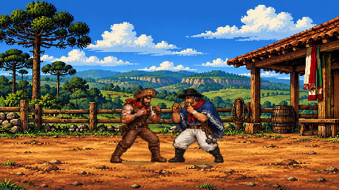

# BRASA — Ecos do Brasil

Jogo de luta 2D original em pixel art, com personagens brasileiros, convidados internacionais e arenas inspiradas em suas histórias.

**Versão de desenvolvimento: 0.14.0.** 76 lutadores · 13 arenas · teclado e dois controles locais · pacote offline para Windows.



## Jogar no PC

Baixe o ZIP em [Releases](https://github.com/rodrigosantossilv/brasa-ecos-do-brasil/releases), extraia e abra **BRASA.exe**. Requer Windows 10/11 e Edge ou Chrome instalado. O launcher incorpora os recursos, extrai e verifica os arquivos localmente; não instala drivers.

Esta é uma versão em desenvolvimento. Não é uma publicação comercial ou uma versão aprovada para Steam.

## Executar o código-fonte

Com Node.js 24, execute:

```sh
npm start
```

Abra `http://127.0.0.1:8943`. O servidor atende somente a máquina local; iniciar o jogo não exige dependências de desenvolvimento. Para desenvolver e testar:

```sh
npm ci
npm run check
npm test
```

## Controles

| Ação | Teclado P1 | PS4 / PS5 | Xbox |
|---|---|---|---|
| Mover / pular / agachar | A D / W / S | Direcional ou analógico | Direcional ou analógico |
| Leve / forte / chute | F / G / H | × / □ / ○ | A / X / B |
| Especiais 1 / 2 / 3 | R / S+R / Frente+R | △ / R2 / L2 | Y / RT / LT |
| Defesa | Para trás ou Shift esquerdo | Para trás ou L1 | Para trás ou LB |
| Agarrão | T | R1 | RB |
| Super com barra cheia | G+R | R3 | RS |
| Dash curto | Dois toques na direção | Dois toques na direção | Dois toques na direção |
| Pausa | Esc | Options | Menu |

P2: setas, J/K/L para golpes, O especial, P agarrão e Shift direito para defender. Os comandos podem ser remapeados e são salvos no perfil local. Controles são lidos pela API Gamepad; conexão e identificação dependem do sistema.

## Combate 0.14

- Simulação fixa de 60 passos por segundo e exibição interpolada.
- Buffer de seis passos, preservado durante o hitstop de 6/8/10 passos.
- Cancelamento de normal confirmado em normal/especial, limitado a três ações.
- Dash frontal/traseiro e direção do salto fixada na decolagem.
- Respiração, avanço/recuo, antecipação, contato sustentado, recuperação, reação e rastros discretos.
- Alcance dos normais calculado pelas poses de contato.
- Os 13 mapas detalhados anteriores foram preservados. F3 mostra limites.

## Organização

```text
game/                  Código do jogo e recursos de execução
scripts/               Servidor, verificações, testes e build
src/launcher/          Launcher C# para Windows
tests/                 Regressões de motor, entrada e rasterização
docs/                  Arquitetura, guias, artes e validação
.github/               CI e modelos de contribuição
```

Leia [arquitetura](docs/ARCHITECTURE.md), [build](docs/BUILD.md), [validação](docs/VALIDATION.md), [artes](docs/ART_ASSETS.md) e [histórico](CHANGELOG.md).

## Gerar o pacote Windows

Em Windows com o compilador do .NET Framework disponível:

```sh
npm run build:pc
```

O resultado fica em `dist/`. Consulte [BUILD.md](docs/BUILD.md).

## Estado e direitos

Os testes automatizados cobrem lógica, entradas simuladas e rasterização nativa. Não medem FPS em todos os computadores e não substituem teste de sensação no controle físico. O repositório começa privado e não concede licença de código aberto; veja [LICENSE](LICENSE). A distribuição comercial requer revisão dos direitos dos materiais.
