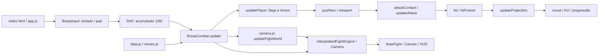
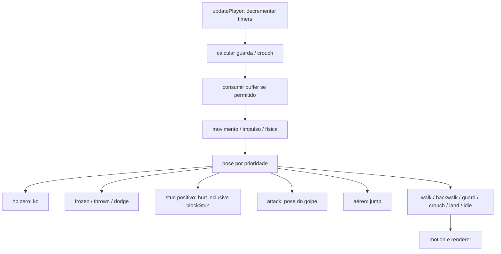
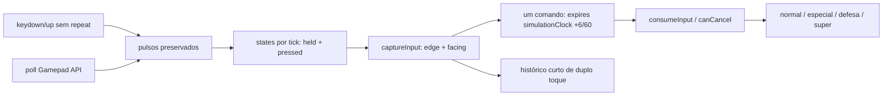

# Auditoria técnica do combate — BRASA 0.15

## Escopo e baseline

Fase 1: observar, medir e propor. Não alterar o gameplay, a arte, o elenco,
as arenas ou a progressão. A caminhada experimental 0.16 permanece fora desta
auditoria. Baseline publicado: `08e8701fb1e4c60338e66bab374d89dc264938b2`,
árvore `f41a5cdd18fe2fe92488774065918b536e963344`. O checkout local equivalente
é `8de173896d30eab0d3b319403cb792243e153340` (mesma árvore, histórico diferente).

## Mapa confirmado antes de instrumentar

Engine própria em JavaScript de browser, Canvas 2D e DOM. `package.json` define
Node >=24 para ferramentas e testes; não é Godot nem Unity. C# é apenas o
launcher Windows offline. `game/index.html` carrega 14 scripts locais;
`game/app.js` inicializa a interface e agenda `requestAnimationFrame(frame)`.

| Subsistema | Arquivo / função observada | Comportamento |
|---|---|---|
| Loop lógico/render | `game/app.js`, `frame` | Acumulador de 1/60 s; render interpolado separado; máximo .25 s de catch-up |
| Combate | `game/combat.js`, `BrasaCombat.update` | Movimento, contato, dano, projéteis, rounds; timers em segundos |
| Input | `game/input.js`, `BrasaInput`; `combat.js`, `captureInput` | Teclado/gamepads, pulsos, seis ticks de buffer, atalhos de especiais |
| Golpes/elenco | `game/moves.js`, `BRASA_MOVES`; `game/data.js` | 76 kits, overrides de normais, especiais, combos, supers; metadados do elenco |
| Animação/geometria | `game/moves.js`, `BrasaMoveTiming`, `BrasaSpriteGeometry`; `game/render-fighters.js` | Atlas, poses, bounds opacos, contato sincronizado; não depende de callback de sprite |
| Colisões | `combat.js`, `attackContact`, `hurtbox`, `normalHurtbox`, `pushBox`, `separatePlayers` | Alcance analítico; hurtbox e pushbox distintos; agarrão com condições próprias |
| Dano/defesa | `combat.js`, `hit`, `hitFreeze`, `defenseStrike` | Hitstop, stun, guardas alta/baixa, counter, orçamento de dano |
| Câmera | `game/camera.js`; `app.js`, `updateFightWorld` | Mundo 2880, viewport 960, follow .1/tick, clamp; zoom fixo 1 |
| Apresentação | `render*.js`, `presentation.js`, `combat-fx.js` | Arenas, entradas, efeitos, cinematic supers; apresentação não dirige o RAF lógico |
| Progressão | `game/story.js`, `world-map.js` | História/desbloqueios; fora do escopo de mudança |
| Testes/debug | `tests/*`, `scripts/test.cjs`; `app.js`, `handleStructureDebug` | 11 suites; F3 mostra limites/camadas, não hitboxes de combate |



## Resultado executivo

A fundação de 60 Hz já existe e passou nos cenários automatizados. Não se
justifica substituí-la. A dívida principal é tornar explícitos e inspecionáveis
os frames, as transições e as regras que hoje estão distribuídas entre timers,
flags, dados dos kits e colisões analíticas.

- **11/11 suítes existentes passaram**, sem alterar o runtime.
- **8 verificações adicionais de auditoria passaram**, incluindo 100 repetições
  de uma sequência de 360 ticks com CPU semeada.
- O RAF real do app executou **720 ticks em 12 segundos** em agendas de
  **30/60/120/144 Hz**, com hashes idênticos de combate e câmera. DOM/Canvas
  foram simulados; isto não é um benchmark de GPU nem prova de fluidez visual.
- Foram extraídas **1.140 linhas**, 15 ações para cada um dos 76 lutadores:
  nove normais por postura, agarrão, três especiais, resposta defensiva e super.
- Defeito reproduzido: durante blockstun o ator conserva `guard=true` e
  `blockStun=true`, mas escolhe a pose **`hurt`**. Isso prejudica a distinção
  visual entre defesa e dano; não significa que o bloqueio deixou de funcionar.
- Nenhum problema **CRITICAL** foi comprovado pelos cenários desta auditoria.
  Isso não equivale a certificar ausência de bugs no jogo inteiro.

Arte, ataques, controles, balanceamento, mapas e progressão permanecem iguais
à árvore publicada. Esta entrega termina na Fase 1.

## Arquivos e dependências

O inventário completo dos arquivos textuais relevantes, com linhas encontradas,
está em [relevant-files.md](../reports/relevant-files.md). Imagens são recursos
binários, não código a ser pesquisado por palavras; seus manifests também são
listados. A árvore funcional é:

```text
game/
  index.html, style.css       bootstrap / interface
  assets.js, assets/*.json    atlas e manifests de arte
  data.js                    lutadores, atributos e arenas
  moves.js                   76 kits + timing compartilhado + geometria
  input.js                   teclado, dois gamepads, remapeamento
  combat.js                  regras autoritativas
  camera.js                  coordenadas de mundo e viewport
  render-fighters.js         quadros, transforms e sombras
  render-stages.js            fundos restaurados e animação ambiente
  render.js                  facade de render
  presentation.js            entradas, supers, finais
  combat-fx.js               desenhos de ataques especiais
  story.js, world-map.js      campanha e desbloqueios
  app.js                     telas, acumulador, interpolação e HUD
scripts/
  test.cjs, check.cjs         runner e integridade
  generate-geometry.cjs       extração offline de bounds opacos
  build-pc.cjs, zip.cjs        distribuição Windows
  serve.cjs, lib.cjs          servidor / ferramentas
  audit-combat.cjs            observador isolado desta auditoria
tests/
  *-v14-check.cjs             regressões de combate/app/render
  *-v15-check.cjs             trocas, mobilidade e HUD
  story-specials-check.cjs    apresentação/colisão dos especiais
  combat-audit-check.cjs      novas verificações da Fase 1
src/launcher/Launcher.cs      launcher, não uma engine C# de combate
```

`combat.js` lê `BRASA_MOVES`, `BrasaMoveTiming` e `BrasaSpriteGeometry` criados
por `moves.js`. Não chama DOM, Canvas, relógio de parede ou pixels de textura.
A geometria é extraída offline de 4.864 poses; não há readback de PNG por tick.
O renderer também consome o timing compartilhado. `app.js` conecta eventos a
HUD/apresentação e atualiza a câmera após a simulação. `story.js` recebe os
resultados sem controlar os frames de contato.

## Ordem real de um tick

`app.js:frame` recebe timestamp do RAF, chama `input.poll`, acumula no máximo
0,25 s e executa, para cada passo: captura anterior → `engine.update(1/60)` →
câmera → consumo dos pulsos. Desenha uma vez, com `alpha=accumulator*60`.
Taps de teclado/gamepad sobrevivem aos RAFs sem tick e são consumidos uma vez
num catch-up. Render pode ocorrer mais ou menos vezes que a simulação.

Dentro de `BrasaCombat.update`:

1. Clamp de `dt` a 0..0,05; relógio geral, efeitos e controles/CPU.
2. Ramos de intro, super, finisher, resultado. Não são o mesmo estado da luta.
3. Na luta: facing e captura de input, **inclusive durante hitstop**.
4. Com hitstop positivo: decrementa freeze e retorna. Não avança ataques,
   física, stun ou cronômetro. `simulationClock` também fica parado.
5. Decrementa cronômetro; expira cadeias; atualiza os dois jogadores.
6. Resolve separação/paredes/viewport; captura contatos de normais elegíveis
   para permitir troca simultânea justa; resolve ataques e depois projéteis.
7. Reaplica limites/facing; clamp de vida/barra; verifica fim do round.

`updatePlayer` decrementa timers, computa guarda, consome comando, move e
integra o salto, incrementa `attack.time`, escolhe pose e atualiza motion.
`updateAttack` checa contato e só então encerra o recovery. Um ataque recém
criado já recebe `dt` no mesmo tick: não há um frame obrigatório com `time=0`.

**Escopo do timestep:** 60 Hz é garantido pelo app. A API pública
`engine.update(dt)` aceita outros dt até 0,05; consumidores isolados podem
produzir quantização diferente. A Fase 2 deve formalizar `step(input)` sem
substituir o acumulador que já funciona.

**Pausas longas:** o teto de 0,25 s descarta tempo de parede após stalls grandes.
Não promete recuperar todos os frames de uma aba suspensa. O HUD de dano recente
e a atmosfera dos mapas usam tempo de apresentação, sem determinar dano.

## Estados, movimento e animação

Há estados globais explícitos: `intro`, `fight`, `super`, `roundOver`,
`finishWindow`, `finisher`, `matchOver`. O lutador usa flags/timers (`grounded`,
`attack`, `stun`, `blockStun`, `root`, `frozen`, `dashTime`, `thrownTime`, etc.)
e uma pose derivada. Não há FSM única com `stateFrame`, validação de transições
ou prioridade documentada de todas as combinações.



O salto integra velocidade inicial + gravidade 1190; a direção é travada na
decolagem. Em Bento: velocidade 474,7, primeiro tick já tem `y=7,7464` e
`grounded=false`; a fase visual `takeoff` dura até 0,04 s. Portanto **0,04 não é
startup no chão**. O salto neutro medido pousou no tick 48. `landingTime=.1`
serve à apresentação; pressionar golpe no próximo tick já inicia ataque.
Não existe recovery de pouso obrigatório de seis frames.

Dash usa duplo toque em até .22 s, duração .16 para frente/.14 para trás,
cooldown .36 e velocidade 2,35×/1,95× a caminhada. Durações são timers
fracionários, não valores inteiros declarados. Dodge é outra ação: .28 s,
invulnerabilidade .15 s, cooldown 1,1 s. Ambos têm regras próprias.

A caminhada tem oito células autorais para frente e oito para trás, indexadas
pela distância percorrida (strides 112/96). Os 76 kits têm `movement`; por
exemplo, Bento anda 183,3 unidades/s e recua 120,9; Jana anda 270,3 e recua
198,9. Ter células distintas não prova boa qualidade artística: pés deslizando,
roupas incoerentes e rigidez exigem revisão visual separada. A branch 0.16 não
é evidência de correção nesta versão.

O renderer recebe relógio simulado/interpolado, usa antecipação/contato/recovery,
respiração, squash/stretch e reação leve. Hitstop segura a célula de impacto.
Não são eventos de animação que iniciam dano. Há, porém, **dependência de dados
de arte**: bounds dos sprites determinam alcance/hurtbox de normais. Atualizar
atlas/geometria pode alterar spacing mesmo sem mudar o valor `range` do kit.

## Caixas, contato e dano

| Conceito | Implementação atual | Limite observado |
|---|---|---|
| Hitbox | `attackContact`: alcance horizontal + faixa vertical, direção, ground/throw e janelas; projéteis usam círculo/AABB | Não há timeline universal de múltiplos retângulos ofensivos por tick |
| Hurtbox normal | `normalHurtbox`: bounds opacos da pose atual, espelhamento e pequeno offset | Engloba a silhueta numa caixa; não separa cabeça/tronco/membros |
| Hurtbox especial/projétil | `hurtbox`: envelope visual/base com altura de crouch | Difere da vulnerabilidade usada contra normais |
| Pushbox | `pushBox`: silhueta neutra estável, folga de 4 unidades, resolução com paredes/ordem anterior | Não é igual ao envelope de cabelo/roupa nem à caixa ofensiva |
| Throwbox | Regra de alcance + alvo no chão e não agachado; `throw` ignora guarda | Não existe objeto/timeline serializável de throwbox |

Não existe “um único collider para tudo”; classificá-lo como dívida crítica
seria incorreto. A separação parcial já foi testada em ambos os facings.
`separatePlayers` transfere a correção que bate na parede para o outro corpo e
preserva ordem em impulsos. Golpes `pass` e cruzamentos aéreos são exceções
deliberadas. Não prometer ausência de overlap em qualquer combinação de poderes.

```mermaid
flowchart LR
  TM[tempo do ataque + BrasaMoveTiming] --> EL[ativo? nextHit? alvo elegível?]
  EL --> GEO[alcance / altura / facing / corpo]
  GEO --> INV[invulnerabilidade]
  INV --> CTR[counter frontal e não low/throw]
  CTR --> GUARD[guarda + altura + lado de chegada]
  GUARD --> DAMAGE[scaling / armor / orçamento de dano]
  DAMAGE --> IMP[HP / vx / stun / freeze / launch]
  IMP --> EVT[eventos / combo / KO]
```



Normais confirmados causam stun compartilhado: .42 s para light e .58 s para
heavy/kick. Base recovery é multiplicado por .72 e dividido por `normalScale.speed`;
overrides por kit alteram startup/active/recovery. Assim, ler apenas a primeira
tabela `NORMALS` fornece frame data incorreto.

Hitstop comum: light/kick/grab 6, heavy 8, especiais 10 ticks; bloqueio 2.
Depende de catálogo e pode ser desligado pela opção de teste `hitstop:false`.
Blockstun usa .13 s (8 ticks observados); `blockStun` é um booleano que
compartilha `stun`, não outro contador. Push no hit vira velocidade inicial
`(push || 20)*5`, e no block vira 75 unidades/s. Essa velocidade sofre damping
e colisões; não equivale à distância final de recuo.

Scaling é por ação da cadeia: 1, .85, .70; combos têm limite de três ações e
rotas autorais finitas podem repetir tokens. Armor reduz dano e pode conservar
o ataque. Especiais compartilham orçamento por ativação: 200 de dano/24 chip;
super, 300/36. Vida é 1000. Meter comum: hit +10 atacante/+7 vítima; block +4
vítima, mais +4 na guarda precisa. Buffs, armadura, drain, combo bonus e caps
podem modificar o resultado. Não é uma tabela universal de balanceamento.

Supers usam fase global separada: resolução após .74 s e cinematic de 1,65 s;
no cenário medido, resolução no tick 46 e retorno à luta no tick 101. Freeze
criado no contato é substituído pela trava cinematográfica e zerado na saída.
Por isso a tabela registra **0 ticks adicionais de hitstop de luta**, não 10,
para esse caso. Owner sai com stun mínimo .16; alvo conserva .52 no hit/.13
no block para decrementar quando a luta volta. Finisher é uma fase de resultado,
não um ataque neutro competitivo com startup/active/recovery.

Há lançamento, `thrownTime`, frozen e reação, mas **KNOCKDOWN/WAKEUP com
duração, invulnerabilidade e transições próprias: NÃO IMPLEMENTADO**.

## Input, defesa, especiais e cancels



O buffer existente é **seis ticks ativos**, preservado durante hitstop. Um
comando mais recente pode substituir o anterior; não é uma fila de motions.
Direções são quatro booleanos, diagonais são simultâneas; eixos opostos se
anulam no cálculo do eixo. Há edge detection e diferenciação held/pressed.
O histórico de duplo toque é só direção + instante. Histórico geral por frame,
parser quarter-circle e dragon punch: **NÃO IMPLEMENTADO no runtime**.

Os atalhos simples de PS/Xbox já existem: ×/A light, □/X heavy, ○/B kick,
△/Y especial 1, R2/RT especial 2, L2/LT especial 3, L1/LB guarda,
R1/RB agarrão, R3/RS super. Menus, reconnect e remapeamento são persistidos.
O teclado usa F/G/H, R com modificador direcional, T e Shift (P1); setas e
J/K/L, O/P, Shift direito (P2). Não remover os atalhos ao acrescentar motions.

Normais podem cancelar durante seu envelope ativo após hit confirmado.
Whiff/block não confirmam; special/throw não cancelam pela regra geral. Máximo
de três ações, sem repetição fora de prefixos autorais. Exceção documentada:
heavy não confirmado nos primeiros .08 s pode aceitar o acorde de super com
barra cheia. Não há `cancelStart/cancelEnd` autoral por golpe no formato atual.

Guardar para trás ou segurar block funciona no chão; low exige crouch,
overhead exige de pé, mid aceita ambos. Throws vencem guarda; contra projétil
o lado de chegada controla frente/recuo. `guardAge<=.11` dá guarda precisa
e counterWindow .4; `defenseStrike` é resposta custando 20 ou gratuita nessa
janela. Isso **não é parry direcional de SFIII**. `PARRY`, tipos ground/air/red,
cooldown e wakeup invulnerability: **NÃO IMPLEMENTADO**.

Os especiais já são data-driven, mas sua execução possui ramos para copy,
teleport, projectile, buff, armor, counter, float, stance e legacy. Copy depende
do oponente; os dados da auditoria usam Bento como alvo. Outros alvos exigem
outras linhas/contextos. Três especiais por lutador não significam três
retângulos simples com a mesma duração.

## IA, câmera e cenários

`cpuInput` usa LCG semeado, emite ações pelo mesmo pipeline e possui atraso
de reação e escolha de rotas após confirmação. Não usa `Math.random` na lógica
de combate. A repetição semeada foi testada; não foi avaliada a dificuldade
para jogadores humanos nem o balanceamento entre os 76 lutadores.

O mundo lógico tem 2880 unidades. A câmera segue o ponto médio com alpha .1
por tick de 60 Hz, clamp e margens dos sprites. `screenX=worldX-camera.x`;
zoom está fixo em 1 e shake da câmera está desativado, conforme restauração
dos mapas. Não reativamos zoom/shake nesta auditoria.

Importante para o antigo relato de “não pertencer ao mapa”: `drawWorld` delega
à composição clássica fixa na tela. O fundo restaurado não se desloca com o
mundo como o chão lógico dos lutadores. Há offsets/sombras por arena, mas não
um plano de chão mundial com marcos acompanhando a câmera. É um risco visual
identificado no código, não autorização para reconstruir as arenas nesta fase.

## Instrumentação entregue e convenções

Executar `node scripts/audit-combat.cjs`. O arquivo carrega o código real em VM
e envolve métodos públicos com observadores. Nenhum script é incluído em
`game/index.html`, e nenhum valor de gameplay é alterado. `AuditSession` tem
`DEBUG_COMBAT` para desligar logs; teste compara o estado com logs on/off.

O observador fornece `simulationFrame` externo (cada chamada fixa, inclusive
freeze), `activeFrame` (relógio simulado que respeita hitstop), histórico de
120 ticks por jogador, held/pressed e numpad relativo/absoluto. Eventos:
INPUT, STATE_CHANGE, ATTACK_START, ACTIVE_START, HIT, BLOCK, ACTIVE_END,
RECOVERY_END, LANDING. Eventos PARRY/KNOCKDOWN/WAKEUP são marcados ausentes,
não inventados. Estados do observador são **classificação derivada**, não FSM
nova do jogo. `ACTIVE_START/END` indicam o envelope do timer; `BOX` distingue
contato realmente elegível e projétil liberado. `RECOVERY_END` inclui motivo
timer/interrupção detectada no atualizador; não é um bus completo de rollback.

Exemplo de trace real em [combat-trace.json](../reports/combat-trace.json):
`simulationFrame`, `fighter`, `event`, `move` e `moveFrame`; inputs retêm
sequências 2→3→6 e 6→2→3 sem afirmar que o runtime as reconhece como golpes.

### Leitura do CSV

[frame-data-current.csv](../reports/frame-data-current.csv) e
[attack-timelines.md](../reports/attack-timelines.md) são gerados do runtime.

1. `startup` conta ticks estritamente anteriores ao envelope ativo;
   `first_active_tick` é o frame convencional do primeiro contato possível.
   Exemplo: cinco ticks S significam primeiro A no tick 6, **não startup
   convencional de 5**. `total=startup+active+recovery` nessa partição.
2. Os valores originais permanecem nas colunas `*_seconds`. Não se arredondou
   cada fase independentemente: o timer acumula `1/60`, com os mesmos testes
   de fronteira e floating point do código publicado.
3. `active` é o envelope, não garantia de hitbox em todo tick. `offensive_ticks`
   contém os ticks corpo a corpo elegíveis; especiais sequenciados podem ter
   lacunas. Projéteis vivem além do recovery e têm delay, trajetória e alvo.
4. Ações aéreas são medidas em altura de teste 10000 para obter sua duração
   completa sem pouso. Em luta real a aterrissagem pode truncá-las.
5. Hit/block são provas isoladas do resolver no primeiro contato, sem combo,
   armor/buff prévio ou parede. A vantagem é diferença entre o primeiro
   pós-tick em que cada ator termina sua trava/ataque; **não é uma constante
   gravada no move**, nem prova de que o próximo golpe alcançará o adversário.
6. Para projétil/counter a vantagem exige contexto espacial/condicional e está
   `NÃO ESPECIFICADO (contextual)`. Durações e impulsos do primeiro projétil
   são medidos separadamente do corpo. Counter é resposta condicional.
7. `pushback_*` é vx inicial em unidades de mundo/s; `meter_gain_*` contém
   `atacante|defensor`. Invulnerability lista ticks observados; não existe
   bitmask invuln por frame. Buff sem ataque e block de throw são `NÃO APLICÁVEL`.
8. `cancel_start/end` consulta o normal como se já tivesse confirmado uma
   primeira ação, para um próximo token distinto. Não abre cancel em whiff
   nem inventa janela autoral. Supers têm colunas cinematográficas próprias.
9. Falta de sistema é `NÃO IMPLEMENTADO`; falta de medição contextual é
   `NÃO ESPECIFICADO`; incompatibilidade conceitual é `NÃO APLICÁVEL`.

| Bento / ação | S | A | R | Total | Primeiro A | Hitstop hit/block | Stun hit/block | Vantagem hit/block no probe |
|---|---:|---:|---:|---:|---:|---|---|---|
| Nó de Couro | 5 | 5 | 10 | 20 | 6 | 6 / 2 | 26 / 8 | +12 / -6 |
| Punho do Sertão | 13 | 7 | 17 | 37 | 14 | 8 / 2 | 35 / 8 | +12 / -15 |
| Bota de Poeira | 9 | 7 | 14 | 30 | 10 | 6 / 2 | 35 / 8 | +15 / -12 |
| Sol Rachado | 13 | 7 | 23 | 43 | 14 | 10 / 2 | 23 / 8 | -6 / -21 |

```text
Bento / Nó de Couro, sem contato
FRAME  01 02 03 04 05 06 07 08 09 10 11 12 13 14 15 16 17 18 19 20
STATE   S  S  S  S  S  A  A  A  A  A  R  R  R  R  R  R  R  R  R  R
BOX     .  .  .  .  .  X  X  X  X  X  .  .  .  .  .  .  .  .  .  .
CANCEL  .  .  .  .  .  C  C  C  C  C  .  .  .  .  .  .  .  .  .  .
INVULN  .  .  .  .  .  .  .  .  .  .  .  .  .  .  .  .  .  .  .  .
```

O C acima é possibilidade **após confirmação**, não cancel em whiff.

## Problemas por severidade

**CRITICAL:** nenhum comprovado. Não há evidência para dizer que render Hz muda
o dano ou que existe só um collider geral. As prioridades abaixo combinam
defeitos verificados e lacunas que impedem tuning preciso; são distinguidas.

| ID / severidade | Evidence e arquivo/função | Consequência | Correção recomendada | Esforço estimado | Risco |
|---|---|---|---|---|---|
| H1 HIGH — dados temporais distribuídos | `combat.js:NORMALS`, `normalDefinition`, `hit`, `hitFreeze`, `beginSuper`; timers fracionários, recovery×.72, stun .42/.58, block .13 | Não basta editar um kit para controlar todos os frames/feedback; quantização e defaults escondidos | Adaptador AttackData compatível, exportar ticks observados antes de migrar a inteiros | 3–5 dias | Alto: fronteiras de contato/cancel |
| H2 HIGH — timeline de colisão parcial | `moves.js:BrasaMoveTiming`, `combat.js:attackContact`, `normalHurtbox`, `hurtbox` | Normais e especiais têm vulnerabilidade diferente; `active` não descreve sozinho cada janela ofensiva | Timeline independente com tipos de caixas e campos por frame, mantendo adapter do alcance atual | 4–7 dias | Alto: spacing de todo o elenco |
| H3 HIGH — estado implícito | `combat.js:updatePlayer`, `consumeInput`, flags; super desvia o update normal | Regras de stun, pouso, armor e cancel são difíceis de inspecionar ou serializar | Invariantes e stateFrame primeiro; migração gradual, preservando exceções autorais | 3–5 dias | Alto: combinações especiais |
| M1 MEDIUM — pose de blockstun vira hurt (defeito) | `updatePlayer` prioriza `p.stun>0?'hurt'`; probe: guard/blockStun true e pose hurt | Contato defendido parece dano após hitstop | Selecionar reação de block distinta mantendo timers/dano; teste com app/renderer | 0,5–1 dia | Baixo/médio: somente seleção visual |
| M2 MEDIUM — sem ferramentas integradas de frames | `app.js:handleStructureDebug`, F3 só camadas/mundo; sem contador lógico runtime | Jogador/desenvolvedor não inspeciona contato/recovery/input por tick | Overlay opt-in e step usando exatamente o loop fixo | 2–3 dias | Médio: pausa, pulsos e hitstop |
| M3 MEDIUM — sem histórico/parser geral | `input.js:states`, `combat.js:captureInput`, um pending command, seis ticks | Não há reprodução de motions nem inspeção de comandos substituídos | Ring de input por tick; parser opcional, preservando atalhos PS5 e buffer atual inicialmente | 2–4 dias | Médio: prioridade/consumo |
| M4 MEDIUM — fundo e chão lógico em espaços diferentes | `render-stages.js:drawWorld` delega a classic.draw ignorando camera; `app.js:drawFight` move atores no mundo | Risco de patinação/perda de ancoragem com câmera; precisa avaliação visual | Medir deslocamento chão/pés; propor composição compatível, em trabalho separado aprovado | 1–2 dias para prova | Alto se reconstruir mapas; não feito |
| M5 MEDIUM — sem knockdown/wakeup/parry próprios (lacuna) | `hit` só launch/thrownTime/frozen; `defenseStrike` é counter | Não há okizeme ou defesa de timing equivalentes à proposta SFIII | Especificar comportamentos e testes antes de introduzir mecânica | 3–6 dias | Alto: muda regras |
| M6 MEDIUM — snapshot não restaura combate | `snapshot` reduz ataque à string e projéteis à contagem; sem load | Não suporta replay/rollback completo, apesar de teste determinístico local passar | save/load de estado puro, IDs e Sets, RNG/input inclusos; round-trip/resim | 3–5 dias | Alto; rollback online adiado |
| L1 LOW — API aceita dt variável | `update` clamp .05, app passa 1/60 | Novo consumidor pode perder a garantia do app | Expor `step` fixo e validar chamadas de simulação | 0,5–1 dia | Baixo com adapter |
| L2 LOW — duplicação de seleção de quadros | `render-fighters.js:authoredFrame` delega primeiro a `BrasaSpriteGeometry.sampleFrame`, mas mantém fallback semelhante | Correção em um caminho pode não chegar ao fallback | Identificar consumidores, testar modo sem geometria e consolidar só depois | 1–2 dias | Médio |
| L3 LOW — legacy/defaults e números mágicos | `SPECIALS`, `legacySpecial`, `MOBILITY`, BODY e constantes de câmera | Caminhos de compatibilidade e campos ausentes dificultam validação | Inventariar fallback alcançável, adicionar schema; remover só com evidência | 1–2 dias | Médio |

Estimativas são ordens de grandeza de trabalho, não prazo prometido. Não
implementamos as correções acima nesta entrega. M1 é o defeito visual
reproduzido; H1–H3 são prioridades de arquitetura para a próxima fase.

## Testes, erros e limites

Comandos usados, Node 24, sem instalar framework:

```powershell
npm test
node scripts/audit-combat.cjs
node tests/combat-audit-check.cjs
npm run check
```

Dependências fixadas pelo projeto foram resolvidas da instalação local já
existente usando `NODE_PATH`; isso não modifica `package-lock.json`. O runner
usual continua com suas 11 suítes. A auditoria é executada separadamente.

| Evidência | Resultado |
|---|---|
| Suítes de integridade, combate, mobilidade, HUD, app, render e especiais | 11/11 passaram |
| Instrumentação/frame data, inputs e RAF ampliado | 8 verificações, zero falhas |
| Repetição com CPU, seed 123, 360 ticks, 100 execuções | 1 hash; logs on/off idênticos |
| RAF real com input/câmera, 720 ticks, 30/60/120/144 Hz | Mesmos hashes de estado e câmera |
| Normais/poses/ataques extraídos | 76×15 = 1.140 linhas; 1.064 timelines comuns, 76 supers cinematográficos |
| Check estático/ordem offline/manifests | Resultado registrado em combat-audit-validation.json |

Hashes completos e método: [combat-audit-tests.json](../reports/combat-audit-tests.json)
e [combat-audit-evidence.json](../reports/combat-audit-evidence.json).
As suítes anteriores incluem 456 contatos normais e 456 whiffs medidos em PNG
nos dois facings. Isso cobre a geometria testada, não toda combinação de poses.

Erros de teste: **nenhum nos comandos concluídos acima**. O defeito de pose
foi medido como comportamento atual e não disfarçado por um teste esperando
uma correção que ainda não foi feita. Nenhum teste de mecanismo inexistente
foi marcado como aprovado.

**NÃO ESPECIFICADO / NÃO ENCONTRADO:** requisito mínimo de hardware, tempo de
GPU, latência de teclado/pad física, FPS/p95/p99 no notebook, métricas do vídeo
com input sincronizado, vantagem de todos os projéteis em todas as distâncias,
resultado de copy contra todos os alvos, equilíbrio dos matchups e restauração
completa de estado. Não foram testados controles físicos nesta etapa.

O determinismo comprovado vale para esta versão, runtime Node e scripts
descritos. Não prova bit-exact entre engines JS, plataformas, drivers ou rede.
Floating point, event callbacks externos e RNG customizado precisam de
contrato antes de prometer rollback. O observador não fica ligado ao jogo final.

## Próxima etapa e ponto de parada

Veja [comparação com SFIII](../reports/brasa-vs-sfiii.md) e o
[plano técnico da Fase 2](combat-phase-2-plan.md), incluindo critérios de
aceite, viewer, testes e diagramas propostos. **Parada na Fase 1:** nenhuma
migração de gameplay, mecânica de parry, reconstrução de mapas ou versão 0.16
é declarada pronta por este relatório.
