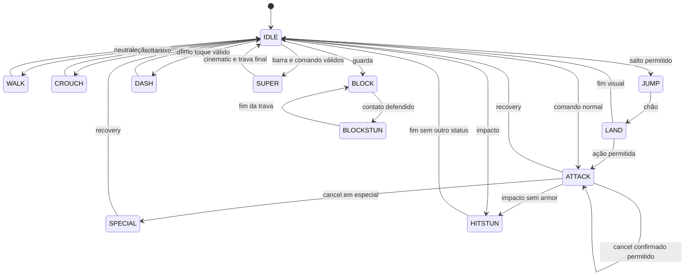
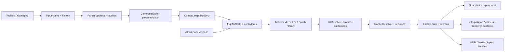
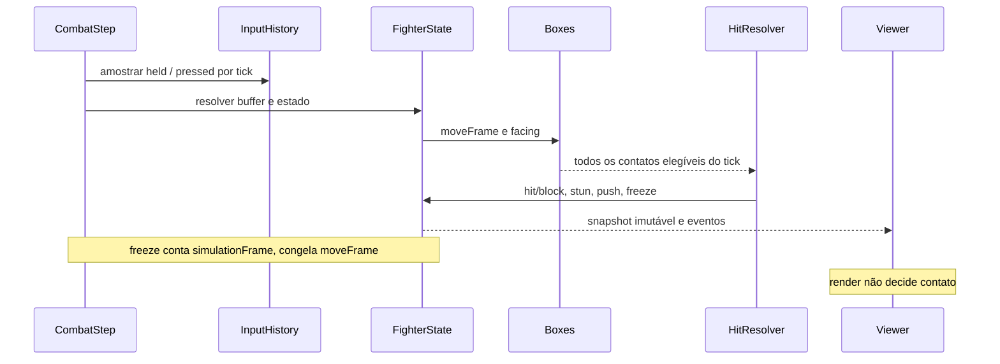
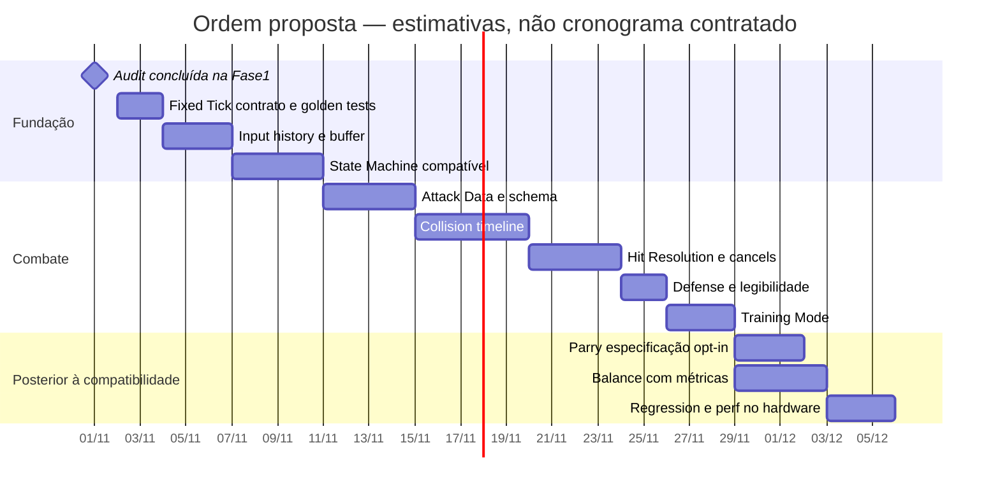

# Fase 2 proposta — contrato de frames com compatibilidade

> Registro da proposta após a auditoria0.15. As mudanças entregues na0.16 e seus limites estão em [COMBAT_V16.md](COMBAT_V16.md).

**Status: proposta, não executada.** A Fase 1 termina nesta entrega. O jogo
publicado continua 0.15. O plano não substitui personagens, assets, golpes,
arenas ou progressão e não remove os atalhos do controle PS5/Xbox.

## Objetivo e sequência de commits pequenos

### 1. Contrato de tick e baseline de compatibilidade

Arquivos: `game/combat.js`, `app.js`, novo módulo de constantes temporais e
`tests/combat-frame-check.cjs`.

- Manter o acumulador e interpolação atuais. Acrescentar `COMBAT_SIMULATION_HZ=60`
  e `step(inputs)`; `update(dt)` fica como adapter temporário para consumidores.
- `simulationFrame` incrementa em todo passo, inclusive hitstop. Separar
  `actionFrame`/`moveFrame` que congelam e `roundFrame` conforme a regra atual.
  Pausa do usuário não chama step. Distinguir freeze global e frozen individual.
- Gerar snapshots de ouro das 1.140 ações atuais, contatos, direções e corners.
  Não usar `Math.round(seconds*60)` para cada fase sem verificar as fronteiras:
  preservar primeiro contato, último contato e fim medidos na Fase 1.
- Validar todos os caminhos de início/fim de round e entrada de super.

Aceite: 11 suítes atuais + auditoria passam; RAF30/60/120/144 mantém hashes;
nenhuma alteração involuntária de dano, alcance, especiais ou progressão.
Não precisa “implementar 60 Hz” de novo: esta etapa torna seu contrato explícito.

### 2. Histórico de input e buffer parametrizado

Arquivos: `input.js`, `combat.js`, novos `game/input-history.js`,
`game/command-parser.js`, testes de buffer/motions.

- Armazenar por tick máscara held/pressed/released, numpad absoluto, facing e
  numpad relativo; ring de 120 ticks para viewer e pelo menos 30 para motions.
  Definir política SOCD atual e regra de facing em cross-up/replay.
- Inicialmente `INPUT_BUFFER_FRAMES=6` no modo compatível. Experimentar **5**
  em fixture/flag de tuning, sem torná-lo padrão sem medir atrasos/cancels.
- Não envelhecer comandos durante hitstop, preservando o comportamento atual.
  Especificar prioridade entre super, E2/E3, acordes de guarda, especial e normais.
- Parser opcional 236/623 com tolerância declarada, orientação espelhada e
  consumo único. Nenhum motion é obrigatório para usar os especiais existentes.
  Diferenciar `held`, novo press e OS repeat; não duplicar ação no catch-up.

Aceite: quarter-circle/DP corretos e espelhados, sequências inválidas rejeitadas,
buffer nos limites 4/5/6/7 documentado, taps entre renders e reconnect mantidos.

### 3. Estado explícito e invariantes

Arquivos: `combat.js`, novo `game/fighter-state.js`, regressões de transição.

- Primeiro derivar enum/stateFrame dos campos atuais e detectar combinações
  inválidas. Depois migrar um grupo por commit: movimento, ataque, reação,
  cinematic. Manter timers de buff/status separados do estado de ação.
- Corrigir M1 em commit próprio: blockstun seleciona reação de bloqueio; não
  muda stun, meter, dano ou janela de counter. Verificar renderer real.
- Documentar landing atual cancelável, attack facing travado, salto comprometido,
  armor que conserva ataque, root que impede ações e exceções de pass/teleport.
- Não introduzir knockdown/wakeup/parry por simples mudança de enumeração.



Este é um esboço de transições, não implementação. THROWN, FROZEN, DEFEAT e
VICTORY devem ter contratos próprios; knockdown/wakeup/parry entram só depois
de decisão de design, não como comportamento fictício no adapter.

### 4. AttackData e timing centralizados

Arquivos: `moves.js`, `combat.js`, novo schema/validador e gerador de relatório.

Contrato proposto, com campos que podem ser condicionais:

```text
AttackData {
  id, name, startupFrames, activeWindows[], recoveryFrames,
  damage, hitstopHit, hitstopBlock, hitstun, blockstun,
  pushbackHit, pushbackBlock, hitLevel,
  hitboxesByFrame, hurtboxOverrides, throwboxesByFrame,
  cancelWindows[{start,end,onHit,onBlock,onWhiff,categories}],
  invulnerabilityByFrame, meterGainHit, meterGainBlock,
  knockdown, juggleCost, animationId, soundId, effectId
}
```

- Converter em modo adapter sem renomear golpes. Preservar defaults atuais
  explicitamente, incluindo .72 recovery, buffs e normalScale, até haver tuning.
- Separar timeline corporal, liberação/vida de projétil e cinematic. Copy
  resolve a fonte numa definição com IDs estáveis e contexto do oponente.
- Derivar total e vantagem; não editar vantagem manualmente. Vantagem depende
  do frame de contato, reação, pouso, freeze e posição de corner/projétil.
- Rejeitar frames negativos, janelas fora do total, IDs desconhecidos, invuln
  inválida e caixa não finita. Sem fallback silencioso num novo dado inválido.

Aceite: exportar dados antigos e novos lado a lado; 76 kits válidos; snapshots
mantêm contatos, whiffs e rotas. Qualquer mudança de um tick aparece no diff
e precisa de justificativa de balanceamento, não de arredondamento acidental.

### 5. Timeline de colisões independente

Arquivos: novo `game/combat-boxes.js`, `combat.js`, `moves.js`, renderer debug.

- Adapter inicial reproduz `attackReach`, hurtboxes e pushbox neutra, sem
  trocar artes. Depois introduzir caixas locais por frame e facing, com root
  e pés explícitos. Dados ofensivos não devem depender de ler pixels em runtime.
- Diferenciar HIT vermelho, HURT verde, PUSH azul e THROW amarelo. AABB/círculo
  e condições ground/air/throw têm tipos próprios. Bounds visuais ficam separados.
- Preservar captura simultânea de contatos normais e as exceções de armor.
  Testar ordem dos slots, paredes, teleports, pass e lançamentos.

Aceite: 456 contatos/456 whiffs atuais continuam corretos; shapes espelhados
com dados finitos; sem atravessar corner ou empurrar adversário com cabelo/arma
que só participa da silhueta visual.

### 6. Resolução de hit e cancel por dados

Arquivos: `combat.js`, novos `game/hit-resolver.js`, `game/cancel-resolver.js`.

- Extrair resolução por etapas e manter mesma ordem: elegibilidade, invuln,
  counter, guarda, orçamento/armor/scaling, dano/reação, confirmação, resultado.
- Hitstop, hitstun e blockstun em contadores exatos. Registrar motivo de stun,
  owner do freeze e contato de origem para explicar o HUD.
- Pushback hit/block independentes, medindo impulso e deslocamento após damping,
  inclusive corner e projectile arriving behind. Manter orçamento por ação.
- Cancel só nos intervalos/categorias declarados e confirmação permitida;
  preservar rotas autorais e tratamento do acorde heavy+special para super.

Aceite: hit único/multihit, troca letal, armored trade, reflexão, chip e caps;
nenhum stun/novo freeze depois de orçamento esgotado; cancels inválidos rejeitados.

### 7. Ferramentas de treino e leitura de vantagem

Arquivos: novo `game/combat-debug.js`, `app.js`, `input.js`, CSS de debug.

Viewer opt-in `DEBUG_COMBAT`, desligado por padrão. Ler estado sem alterá-lo.
Log estruturado em ring limitado; export JSON/CSV manual, sem I/O por tick.
Não inicializar buffers/Canvas extras no caminho de produção com debug desligado.

| Tecla proposta | Função | Conflito e resolução |
|---|---|---|
| F1 | Pausar/retomar simulação | Impedir ajuda do navegador apenas em treino/debug com foco no jogo |
| F2 | Um `step` exato enquanto pausado | Não usar dt de RAF; consumir press uma vez; permitir contar freeze |
| F3 | Hit/hurt/push/throw boxes | Hoje mostra mundo/camadas: mover esse modo para Alt+F3 enquanto debug ligado |
| F4 | Histórico de120frames | Se tecla estiver remapeada, mostrar conflito e oferecer atalho alternativo |
| F5 | Resetar posições/estado de treino | Prevenir reload só no treino/debug; resetar ataque, projéteis, buffers e câmera |

HUD por ator: simulationFrame, actionFrame, estado/stateFrame, move/moveFrame,
startup/active/recovery, freeze restante, hitstun/blockstun, root/pés, facing,
vx/vy, confirmação e vantagem contextual. Preservar a função normal das teclas
fora do modo debug; respeitar remapeamentos existentes e foco de campos de texto.

Vantagem = frame em que defensor fica disponível menos frame em que atacante
fica disponível. Mostrar hit/block, frame do contato e condições; não exibir
um número único enganoso para projétil ou pouso truncado. Mostrar janela de
counter separada de parry.

Aceite manual: iniciar ação, pausar, avançar até primeiro/último A, fim R,
contar freeze/stun, exportar trace e reproduzir. Comparar logs on/off para
assegurar que viewer não muda o jogo. Esta UI não foi implementada na Fase1.

## Arquitetura proposta







Parry e tuning não são pré-requisitos para declarar a migração de compatibilidade
pronta. Rollback online, rede e novos mapas ficam fora da Fase2. Antes de rede,
provar save/load completo e resimulação local; o atual `snapshot()` é insuficiente.

## Matriz de testes proposta

Todos usam ticks/injeção de input, nunca sleeps de tempo real. Os testes abaixo
são **propostos**, salvo a cobertura atual indicada.

| Teste | Fixture/asserção por frame | Cobertura atual / próximo passo |
|---|---|---|
| startup exact | Nenhum contato até N-1; primeiro elegível no N declarado | Bento primeiro A6 medido; ampliar golden para todos |
| active begin/end | Caixa liga em N, desliga em M+1; provar gaps do multihit | Timelines1140 extraídas; validar schema |
| recovery end | Comando antes do fim fica no buffer, ação sai no primeiro tick permitido | Casos básicos existem; todos os moves após migração |
| hit only once | Permanecer sobreposto durante A produz só1hit | Regressões de trades/normais; tabela completa |
| multihit count | Cada subjanela consome alvo só uma vez, dentro do budget | Especiais existentes; enumerar janelas/caps |
| hitstop duration | Congelar move/posição/câmera6/8/10; block2; não expirar input | Já coberto; preservar bordas e super separado |
| hitstun duration | Medir primeira disponibilidade, sem confundir freeze | Resolver medido; timer inteiro exato na migração |
| blockstun duration | Mesmo para block, mantendo pose própria | 8ticks medidos; M1 ainda precisa correção |
| pushback | Impulso e deslocamento em1/5/10ticks, ambos os facings | Projétil/trade/corner cobertos parcialmente |
| corner collision | O agressor empurra até o canto sem atravessar o limite | Suites atuais; repetir com novas boxes |
| pushbox overlap | Testar centros cruzando num impulso e correction contra parede | Já coberto; ampliar matriz pass/teleport |
| jump duration | Arco e pouso de cada perfil, direção comprometida | Salto atual/Bento48ticks e travamento testados |
| landing state | Aéreo termina no pouso; regra cancelável documentada | Já coberto; exigir contrato de landing futuro |
| input buffer | Press antes do fim nos offsets4/5/6/7, com/sem freeze | Seis ticks testados;5 só experimento |
| quarter-circle | 236+P e espelhado; repeats aceitos; sequência/tempo inválidos rejeitados | NÃO IMPLEMENTADO no runtime |
| dragon-punch | 623+P e espelhado, neutros/gaps e consumo único | NÃO IMPLEMENTADO no runtime |
| cancel allowed | Hit confirmado na janela aceita categoria/rota | Já coberto; converter para dados |
| cancel rejected | Whiff/block/fora de janela/4ªação não cancelam | Já coberto; manter exceção de acorde super |
| block high | Mid/overhead frontal defendidos de pé; low vence | Guarda existente; nova matriz exaustiva |
| block low | Low/mid defendidos agachado; overhead vence | Guarda existente; nova matriz exaustiva |
| parry success | Direção dentro da janela futura, freeze/meter definidos | NÃO IMPLEMENTADO; só após especificação |
| parry early failure | Press em start-1 fora da janela não faz parry | NÃO IMPLEMENTADO; não usar janela inventada |
| parry late failure | Press em end+1 não faz parry | NÃO IMPLEMENTADO |
| knockdown | Estado/tipo e duração; não confundir launch com knockdown | NÃO IMPLEMENTADO como sistema |
| wakeup | Recupera exatamente no tick definido; invuln/throw regras | NÃO IMPLEMENTADO como sistema |
| determinismo |100runs do mesmo script, hashes completos; logs on/off | Passou na Fase1; ampliar duração/matchups |
| renderHz | RAF real30/60/120/144 com input lógico idêntico | Passou720ticks; medir FPS/latência física à parte |
| save/load | Snapshot→load→mesmos próximos600inputs igual ao contínuo | NÃO IMPLEMENTADO; não prometer rollback |

## Entrega e estratégia de regressão

Cada etapa tem commit independente com motivo, diff de frame data e evidência.
Revisar invariantes antes de migrar o próximo subsistema. Não acumular uma
reescrita difícil de revisar. Se o adapter divergir, manter o caminho0.15 como
referência até localizar o frame da primeira diferença; não “corrigir” o golden
para ocultar uma mudança não intencional.

Depois da compatibilidade: avaliar em treino dois personagens por arquétipo,
depois os76, com partidas reais e controle físico. Registrar p50/p95/p99 de
update/render, drops e latência de input. A auditoria atual não fornece esses
dados. Alterações de balanceamento e arte exigem critérios próprios de revisão.
