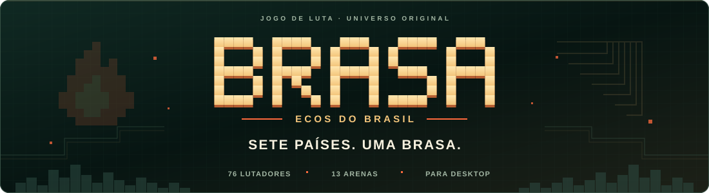
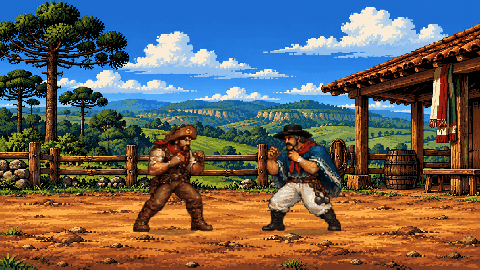

<p align="center">
  
</p>

<p align="center">
  <strong>Brazil becomes the arena. The fight travels the world.</strong><br>
  An original 2D pixel-art fighting game, rooted in Brazilian tales.
</p>

<p align="center">
  <a href="../../README.md">Português (Brasil)</a> · <strong>English</strong>
</p>

<p align="center">
  <a href="https://github.com/rodrigosantossilv/brasa-ecos-do-brasil/releases/tag/v0.16.0"></a>
  <a href="#play"></a>
  <a href="#controls"></a>
  <a href="https://github.com/rodrigosantossilv/brasa-ecos-do-brasil/actions/workflows/ci.yml"></a>
</p>

<p align="center">
  <a href="https://github.com/rodrigosantossilv/brasa-ecos-do-brasil/releases/download/v0.16.0/BRASA-PC-v0.16.zip"><strong>Download for Windows</strong></a> ·
  <a href="../README.md"><strong>Documentation</strong></a> ·
  <a href="#controls"><strong>Controls</strong></a>
</p>

<p align="center">
  
  <br><sub>Version 0.14.0 preview · Bento × Ramiro in the Pampa arena.</sub>
</p>

<p align="center">
  <a href="#the-game">The game</a> · <a href="#play">Start playing</a> · <a href="#develop">Source code</a> · <a href="#documentation">Guides</a>
</p>

<a id="the-game"></a>

## New in version 0.16

Movement profiles for all 76 fighters, fair simultaneous normal trades, jump-and-attack input and safe landing transitions. Projectile blocking follows the incoming side, and health bars highlight recent damage. See the [changelog](../../CHANGELOG.md) and [source-study notes](../COMBAT_REFERENCES.md).

## Tales that enter the fight

From Bento Brasa's backlands to Jana Faísca's capoeira, every fighter brings a story to the arena. The roster begins in Brazil, meets international guests and reaches four secret lunar guardians.

| 76 fighters | 13 arenas | Four game modes |
|---|---|---|
| Characters and fighting styles with three specials and one super per fighter. | Brazilian landscapes, international settings and a trip to the Moon. | Story, CPU duel, local two-player versus and free training. |

Play on a keyboard or with up to two gamepads on the same computer. Remap controls and save settings in your local profile. Multiplayer is local. **The game interface is currently in Portuguese; this page is an English guide.**

<a id="play"></a>

## Play on Windows

**Development package v0.16.0.** Requires Windows 10/11 and an installed copy of Edge or Chrome.

1. Download [BRASA-PC-v0.16.zip](https://github.com/rodrigosantossilv/brasa-ecos-do-brasil/releases/download/v0.16.0/BRASA-PC-v0.16.zip).
2. Extract the ZIP to a folder.
3. Open **BRASA.exe** and select a game mode.

The package includes the assets for offline play. See the [release notes](https://github.com/rodrigosantossilv/brasa-ecos-do-brasil/releases/tag/v0.16.0) and [SHA-256 checksums](https://github.com/rodrigosantossilv/brasa-ecos-do-brasil/releases/download/v0.16.0/SHA256SUMS.txt). Downloads follow the private repository's access permissions.

<a id="controls"></a>

## Controls

| Action | P1 keyboard | PlayStation 4/5 | Xbox One/Series |
|---|---|---|---|
| Move / jump / crouch | A D / W / S | D-pad or left stick | D-pad or left stick |
| Light / heavy / kick | F / G / H | × / □ / ○ | A / X / B |
| Specials 1 / 2 / 3 | R (neutral) / S+R / Forward+R | △ / R2 / L2 | Y / RT / LT |
| Block | Back or left Shift | Back or L1 | Back or LB |
| Throw | T | R1 | RB |
| Super with full meter | G+R | R3 (click) | RS (click) |
| Pause | Esc | Options | Menu |

**P2 keyboard:** arrow keys to move, J/K/L to attack, O for special, P to throw and right Shift to block. Double-tap a direction to dash. “Forward” means toward your opponent.

Open **CONTROLES** in the game to remap inputs. Gamepads use the Gamepad API; connection and identification depend on your system. The [moves and controls guide](../guides/GUIA-GOLPES.md) covers the full commands, defense, dodges and combos in Portuguese.

<a id="develop"></a>

## Run from source

With **Node.js 24**, run this in the project folder:

```sh
npm start
```

Open **http://127.0.0.1:8943**. The server only serves your computer; starting the game does not require installing dependencies.

<details>
<summary><strong>Develop, test and build the Windows package</strong></summary>

Install development tools and run the checks:

```sh
npm ci
npm run check
npm test
```

Run `npm run build:pc` on Windows with the .NET Framework C# compiler available. Output goes to `dist/`. The engine uses a fixed 60-step simulation, input buffering, cancels and hitstop. See [architecture](../ARCHITECTURE.md), [build](../BUILD.md) and [validation](../VALIDATION.md) for details and test coverage.

</details>

<a id="documentation"></a>

## Explore BRASA

The [documentation index](../README.md) and detailed guides are in Portuguese.

| For players | For developers |
|---|---|
| [Roster and arena atlas](../guides/GUIA-ELENCO.md) | [Engine architecture](../ARCHITECTURE.md) |
| [Moves, controls and combos](../guides/GUIA-GOLPES.md) | [Running and building](../BUILD.md) |
| [Each fighter's specials](../guides/PLAYER_SPECIALS.md) | [Validation and test limits](../VALIDATION.md) |
| [Presentation and animation](../guides/GUIA-ANIMACOES.md) | [Art and assets](../ART_ASSETS.md) |

Follow the [changelog](../../CHANGELOG.md) and [GitHub Actions](https://github.com/rodrigosantossilv/brasa-ecos-do-brasil/actions) runs.

BRASA is in development. **All rights reserved**; see [LICENSE](../../LICENSE) for use and distribution terms.
